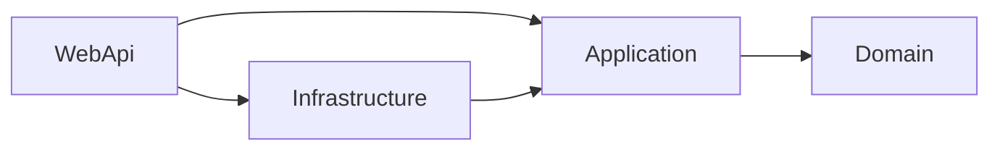
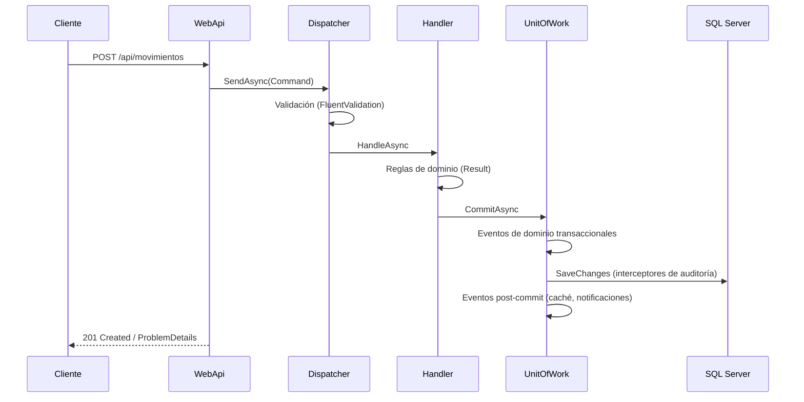

# AppGestionGastos

API REST para la gestión de gastos personales: usuarios, cuentas bancarias, catálogos y movimientos de ingresos y egresos. Está construida con **.NET 10**, **Clean Architecture**, **DDD** y **CQRS**, y se mantiene como proyecto de referencia de buenas prácticas de desarrollo orientado a dominio.


## Tabla de contenidos

- [Resumen para reclutadores](#resumen-para-reclutadores)
- [Stack tecnológico verificable](#stack-tecnológico-verificable)
- [Funcionalidad](#funcionalidad)
- [Arquitectura](#arquitectura)
- [Conceptos de DDD aplicados](#conceptos-de-ddd-aplicados)
- [Características técnicas](#características-técnicas)
- [Decisiones de diseño](#decisiones-de-diseño)
- [API: endpoints](#api-endpoints)
- [Configuración](#configuración)
- [Puesta en marcha](#puesta-en-marcha)
- [Ejemplos de uso](#ejemplos-de-uso)
- [Estructura del repositorio](#estructura-del-repositorio)
- [Roadmap y limitaciones conocidas](#roadmap-y-limitaciones-conocidas)
- [Licencia y autor](#licencia-y-autor)

---

## Resumen para reclutadores

**Qué demuestra este proyecto**

- Diseño por capas con **Clean Architecture** y la regla de dependencias hacia el dominio.
- **DDD táctico**: entidades con invariantes, objetos de valor, eventos de dominio, repositorios y unidad de trabajo.
- **CQRS con dispatcher propio** (sin MediatR), con separación real entre escritura (agregados) y lectura (proyecciones a DTO).
- **Result Pattern** en lugar de excepciones para el flujo de negocio, con traducción a **ProblemDetails (RFC 7807)**.
- **EF Core avanzado**: Fluent API, interceptores (`SaveChangesInterceptor` y `DbCommandInterceptor`), concurrencia optimista, seeding idempotente y migraciones.
- **Caché** con `HybridCache`, etiquetas e invalidación por eventos de dominio.
- **Observabilidad**: Serilog con destinos configurables (consola, ficheros y SQL Server), medición de tiempos de petición y de comandos SQL, y retención de logs con `BackgroundService`.
- **Seguridad**: JWT con roles y políticas, hash de contraseñas con PBKDF2, y secretos fuera del repositorio.
- Configuración tipada con el **patrón de opciones**, validada al arrancar y con cambio en caliente donde procede.

<details>
<summary><strong>English summary</strong></summary>

A REST API for personal expense tracking (users, bank accounts, catalogs and income/expense movements) built with **.NET 10**, **Clean Architecture**, **DDD** and **CQRS** (custom dispatcher, no MediatR). Highlights: Result Pattern with RFC 7807 ProblemDetails, EF Core 10 on SQL Server (interceptors, optimistic concurrency, idempotent seeding), reusable pagination, HybridCache with tag-based invalidation driven by domain events, two-phase domain event dispatching (transactional and post-commit), audit columns via interceptor, Serilog with configurable sinks (console, file, SQL Server) plus a log-retention `BackgroundService`, JWT authentication with role-based policies and PBKDF2 password hashing.

</details>

---

## Stack tecnológico verificable

Cada fila indica dónde está en el repositorio para que pueda comprobarse.

| Tecnología | Uso en el proyecto | Dónde verlo |
|---|---|---|
| **.NET 10 / C#** | Plataforma y lenguaje (constructores primarios, `record`, expresiones de colección, pattern matching, `Guid.CreateVersion7()`, `TimeProvider`) | `Directory.Build.props` |
| **ASP.NET Core** (controladores) | API REST con atributos de enrutamiento y filtros | `WebApi/Controllers` |
| **OpenAPI nativo** | Documento `/openapi/v1.json` con esquema Bearer | `WebApi/OpenApi` |
| **Entity Framework Core 10** | Persistencia con Fluent API, migraciones e interceptores | `Infrastructure/Persistence` |
| **SQL Server** | Base de datos relacional | `appsettings.json` (`ConnectionStrings`) |
| **FluentValidation** | Validación de comandos y consultas, ejecutada por el dispatcher | `Application/Features/**/*Validator.cs` |
| **Serilog** | Logging estructurado con sinks de consola, fichero y SQL Server | `Infrastructure/Logging` |
| **HybridCache** | Caché de catálogos con etiquetas e invalidación | `Infrastructure/Caching` |
| **JWT Bearer** | Autenticación y autorización por roles y políticas | `Infrastructure/Authentication`, `WebApi/DependencyInjection.cs` |
| **PBKDF2-SHA512** | Hash de contraseñas con sal aleatoria | `Infrastructure/Authentication` |
| **BackgroundService** | Retención de logs configurable | `Infrastructure/Logging/LogRetention` |
| **Microsoft.Data.SqlClient** | Operaciones de mantenimiento fuera de EF Core | `Infrastructure/Logging/LogRetention` |
| **Patrón de opciones** (`IOptions`/`IOptionsMonitor`) | Configuración tipada, validada al arrancar | `Infrastructure/**/*Options.cs` |
| **dotnet-ef** | Migraciones y *bundles* | `Infrastructure/Persistence/Migrations` |

---

## Funcionalidad

Gestión de finanzas personales con el siguiente modelo de negocio:

- **Usuarios**: registro público, inicio de sesión y administración por usuarios con rol `Admin`.
- **Bancos, tipos de cuenta y categorías**: catálogos de lectura para todos los usuarios autenticados y de escritura solo para administradores.
- **Cuentas**: cada usuario gestiona sus propias cuentas (banco, tipo, número y saldo).
- **Tipos de movimiento**: Ingreso y Egreso (catálogo cerrado sembrado en la base de datos).
- **Movimientos**: registro de ingresos y egresos sobre una cuenta; el saldo se actualiza automáticamente mediante un evento de dominio, en la misma transacción.

Reglas de negocio destacadas:

- El saldo de una cuenta **solo cambia mediante movimientos**; nunca se edita directamente.
- Un usuario **nunca ve ni modifica** recursos de otro (se responde 404 para no revelar su existencia).
- No se pueden eliminar bancos, tipos de cuenta o categorías **en uso**, ni usuarios con cuentas.
- Un administrador no puede eliminarse a sí mismo ni quitarse el rol `Admin`.

---

## Arquitectura

Cuatro proyectos con una regla fundamental: **las dependencias solo apuntan hacia dentro**.



| Capa | Responsabilidad |
|---|---|
| **Domain** | Entidades, objetos de valor, eventos de dominio, `Result`/`Error` e interfaces de repositorio. Sin dependencias externas. |
| **Application** | Casos de uso (CQRS), validación, DTOs, paginación, handlers de eventos y abstracciones de servicios externos. |
| **Infrastructure** | EF Core, repositorios, unidad de trabajo, dispatcher, interceptores, caché, JWT, Serilog y tareas en segundo plano. |
| **WebApi** | Controladores, middleware, autenticación y autorización, OpenAPI y composición de dependencias. |

### Ciclo de vida de una petición



---

## Conceptos de DDD aplicados

### Entidades con invariantes y factorías

Las entidades no exponen setters públicos y solo se crean con una factoría que valida y devuelve un `Result`. El identificador (`Guid` v7) se genera en el dominio.

```csharp
public static Result<Banco> Crear(string nombre, string codigoInstitucional)
{
    if (string.IsNullOrWhiteSpace(nombre)) return CuentaErrors.BancoNombreVacio;
    if (string.IsNullOrWhiteSpace(codigoInstitucional)) return CuentaErrors.BancoCodigoVacio;

    var banco = new Banco(Guid.CreateVersion7(), nombre.Trim(), codigoInstitucional.Trim());
    banco.Raise(new BancoCreadoEvent(banco.Id));

    return banco;
}
```

### Objetos de valor

`Email` es un objeto de valor inmutable que normaliza y valida en su factoría; se persiste con un conversor de valor.

### Result Pattern

Los errores de negocio son valores tipados, no excepciones. Cada `ErrorType` se traduce a un código HTTP:

| `ErrorType` | HTTP |
|---|---|
| `Validation` | 400 |
| `Unauthorized` | 401 |
| `Forbidden` | 403 |
| `NotFound` | 404 |
| `Conflict` | 409 |
| `Failure` | 500 |

### Eventos de dominio en dos fases

| Fase | Cuándo | Uso típico |
|---|---|---|
| **Transaccional** | Antes de `SaveChanges`, en la misma transacción | Actualizar el saldo de una cuenta al registrar un movimiento |
| **Post-commit** | Tras confirmar en base de datos | Invalidar caché, efectos externos tolerantes a pérdida |

### Repositorios y lectura separada

- **Repositorios de agregado** (interfaz en Domain): cargan y guardan entidades.
- **Repositorios de lectura** (interfaz en Application): proyectan directamente a DTO con `AsNoTracking`, sin pasar por las entidades.

### Unidad de trabajo

`IUnitOfWork.CommitAsync` despacha los eventos pendientes, ejecuta un único `SaveChanges` y lanza los handlers post-commit. Devuelve un `Result`: si un handler transaccional falla, no se persiste nada.

---

## Características técnicas

### CQRS sin librerías externas

Un dispatcher propio y tipado resuelve el handler de cada comando o consulta, ejecuta los validadores y devuelve siempre un `Result`. El registro de handlers y validadores es **automático** (escaneo del ensamblado).

### Validación y gestión de errores

- Validación declarativa con FluentValidation en dos niveles: forma de la entrada (validadores) y reglas de negocio (handlers y dominio).
- Un middleware global transforma excepciones en respuestas **ProblemDetails**; los fallos de validación incluyen los mensajes agrupados por campo.

```json
{
  "type": "https://tools.ietf.org/html/rfc9110#section-15.5.1",
  "title": "Errores de validación",
  "status": 400,
  "detail": "El formato del email no es válido. La contraseña debe tener al menos 8 caracteres.",
  "traceId": "00-8a2e74f4429453d3dfc7e852118e4633-e94f0d57d2b741f4-00",
  "errors": {
    "email": [ "El formato del email no es válido." ],
    "password": [ "La contraseña debe tener al menos 8 caracteres." ]
  }
}
```

### Paginación reutilizable

Todos los listados devuelven una página. Los componentes comunes (`PageRequest`, `PagedResult<T>`, `IPagedQuery<T>`, validador base y extensión `ToPagedResultAsync`) hacen que una consulta nueva solo declare sus filtros. La extensión exige `IOrderedQueryable` para garantizar un **orden determinista** entre páginas.

### Caché con HybridCache

Los catálogos de lectura frecuente se cachean con un **decorador** sobre el repositorio de lectura (sin tocar handlers ni controladores). Todas las variantes paginadas comparten una **etiqueta** por catálogo; al crear, modificar o eliminar un elemento, un evento de dominio post-commit invalida la etiqueta. Los tiempos son configurables.

### Auditoría de datos

Una clase base `AuditableEntity` añade `CreadoEn`, `CreadoPor`, `ModificadoEn` y `ModificadoPor`; un `SaveChangesInterceptor` los rellena automáticamente al guardar, de forma que el código de negocio nunca los gestiona.

### Interceptor de comandos SQL

Un `DbCommandInterceptor` registra los comandos lentos: **Error** a partir de un umbral y **Warning** por encima de otro, ambos configurables en caliente, con interruptor de activación y sin registrar nunca los valores de los parámetros.

### Logging con Serilog

Destinos configurables desde `appsettings`: consola, ficheros rotativos y/o tabla de SQL Server, cada uno con su nivel mínimo. Cada evento incluye el `TraceId` que también devuelven los `ProblemDetails`, para localizar cualquier incidencia.

### Retención de logs

Un `BackgroundService` elimina por lotes los registros más antiguos que el periodo configurado (por defecto, 3 meses). Se activa y configura desde `appsettings` y lee la configuración en caliente.

### Seguridad

- JWT (HS256) con claims `sub`, `email`, `name` y `role`; autorización por **roles y políticas**.
- Contraseñas con **PBKDF2-HMAC-SHA512** (sal aleatoria, 210 000 iteraciones y comparación en tiempo constante).
- El inicio de sesión devuelve el mismo error ante cualquier fallo de credenciales, para no permitir enumerar usuarios.
- Los listados nunca incluyen datos sensibles (el DTO no tiene el hash de contraseña).
- Secretos fuera del repositorio (user-secrets o variables de entorno).

### Persistencia

- Identificadores `Guid` v7 generados en el dominio.
- Relaciones sin propiedades de navegación (los agregados se referencian por Id) y `DeleteBehavior.Restrict`.
- **Concurrencia optimista** (`RowVersion`) en las cuentas, para no perder actualizaciones de saldo.
- Índices únicos para claves naturales (email, código de banco, nombres de catálogo, número de cuenta por banco).
- **Seeding** por tipo de dato: `HasData` para catálogos cerrados, seeders idempotentes para catálogos editables y un seeder de desarrollo (solo en entorno de desarrollo).

---

## Decisiones de diseño

| Decisión | Motivo |
|---|---|
| CQRS con dispatcher propio, sin MediatR | Control total, menos dependencias y firmas adaptadas a `Result` |
| Result Pattern en lugar de excepciones de negocio | Flujo explícito y errores tipados |
| `Guid` v7 generado en el dominio | Unicidad sin depender de la BD, orden aproximado por tiempo e Ids conocidos al crear |
| Eventos de dominio en dos fases | Atomicidad de los cambios de estado y efectos externos fuera de la transacción |
| Repositorios de lectura separados | Proyección directa a DTO y sin exponer campos sensibles |
| Caché por decorador y etiquetas | No modificar handlers ni controladores e invalidar todas las páginas a la vez |
| No se cachean datos por usuario ni saldos | Baja tasa de aciertos, datos muy cambiantes y riesgo de mezclar datos entre usuarios |
| Auditoría con interceptor y clase base | El negocio no rellena campos transversales y no pueden olvidarse |
| Tabla de logs creada por migración | El sink arranca antes que las migraciones |
| 404 para recursos de otros usuarios | No revelar la existencia de datos ajenos |
| Opciones validadas al arrancar | Fallar pronto ante una mala configuración |

---

## API: endpoints

> Los endpoints marcados como **Admin** requieren un token con el rol `Admin`. Los marcados como **Auth** requieren cualquier token válido.

| Método y ruta | Acceso | Descripción |
|---|---|---|
| `POST /api/usuarios` | Anónimo | Registra un usuario (rol `Usuario`) |
| `POST /api/auth/login` | Anónimo | Devuelve un JWT |
| `GET /api/usuarios` | Admin | Lista usuarios con paginación y búsqueda |
| `PUT /api/usuarios/{id}` | Admin | Actualiza nombre, email y roles |
| `DELETE /api/usuarios/{id}` | Admin | Elimina un usuario sin cuentas |
| `GET /api/bancos` | Auth | Lista bancos (paginado, con búsqueda) |
| `POST` · `PUT` · `DELETE /api/bancos[/{id}]` | Admin | Crea, actualiza y elimina bancos |
| `GET /api/tipos-cuenta` | Auth | Lista tipos de cuenta |
| `POST` · `PUT` · `DELETE /api/tipos-cuenta[/{id}]` | Admin | Crea, actualiza y elimina tipos de cuenta |
| `GET /api/categorias` | Auth | Lista categorías |
| `POST` · `PUT` · `DELETE /api/categorias[/{id}]` | Admin | Crea, actualiza y elimina categorías |
| `GET /api/tipos-movimiento` | Auth | Lista tipos de movimiento (ingreso/egreso) |
| `GET /api/cuentas` | Auth | Lista las cuentas del usuario autenticado |
| `POST /api/cuentas` | Auth | Registra una cuenta propia |
| `PUT /api/cuentas/{id}` | Auth | Actualiza número, banco y tipo de una cuenta propia |
| `GET /api/movimientos` | Auth | Lista los movimientos propios con filtros (cuenta, categoría, tipo y fechas) |
| `POST /api/movimientos` | Auth | Registra un movimiento y actualiza el saldo |

Los listados aceptan `page`, `pageSize` (máximo 100) y, según el recurso, `buscar` y filtros. Respuesta de cualquier listado:

```json
{
  "items": [ { "id": "…", "nombre": "…" } ],
  "page": 1,
  "pageSize": 20,
  "totalCount": 37,
  "totalPages": 2,
  "hasPreviousPage": false,
  "hasNextPage": true
}
```

El contrato completo está disponible en `/openapi/v1.json` (entorno de desarrollo).

---

## Configuración

Todos los componentes técnicos se configuran desde `appsettings.json` con el patrón de opciones. Las opciones críticas se **validan al arrancar**.

| Sección | Contenido | Cambio en caliente |
|---|---|---|
| `ConnectionStrings` | Cadenas de conexión | No |
| `Jwt` | Emisor, audiencia, clave (≥ 32 caracteres) y caducidad | No |
| `Serilog` | Nivel mínimo y overrides por categoría | Sí |
| `LogSinks` | Destinos de log: consola, ficheros y base de datos | No |
| `LogRetention` | Activación, meses de retención, intervalo y tamaño de lote | Sí |
| `DbCommandTiming` | Activación y umbrales (aviso y error) de comandos SQL lentos | Sí |
| `CatalogCache` | Activación y expiraciones de la caché de catálogos | Sí |
| `Seeding` | Contraseña de los usuarios de desarrollo | No |

Ejemplo:

```json
"LogSinks": {
  "Console":  { "Enabled": true, "MinimumLevel": "Information" },
  "File":     { "Enabled": true, "Path": "logs/app-.log", "RollingInterval": "Day",
                "RetainedFileCountLimit": 14, "MinimumLevel": "Information" },
  "Database": { "Enabled": true, "ConnectionStringName": "DefaultConnection",
                "TableName": "Logs", "MinimumLevel": "Warning" }
},
"LogRetention":    { "Enabled": true, "RetentionMonths": 3, "IntervalHours": 24, "BatchSize": 5000 },
"DbCommandTiming": { "Enabled": true, "WarningThresholdMs": 1000, "ErrorThresholdMs": 3000 },
"CatalogCache":    { "Enabled": true, "Expiration": "00:30:00", "LocalCacheExpiration": "00:05:00" }
```

---

## Puesta en marcha

### Requisitos

- [SDK de .NET 10](https://dotnet.microsoft.com/download)
- SQL Server (LocalDB, instancia local o contenedor)
- Herramienta de EF Core: `dotnet tool install --global dotnet-ef`

SQL Server en un contenedor (opcional):

```bash
docker run -e "ACCEPT_EULA=Y" -e "MSSQL_SA_PASSWORD=<contraseña-segura>" \
  -p 1433:1433 -d mcr.microsoft.com/mssql/server:2022-latest
```

### Pasos

```bash
# 1. Clonar y compilar
git clone <url-del-repositorio>
cd AppGestionGastos
dotnet build

# 2. Secretos (nunca se guardan en el repositorio)
cd src/AppGestionGastos.WebApi
dotnet user-secrets init
dotnet user-secrets set "Jwt:SecretKey" "<clave-aleatoria-de-32-o-mas-caracteres>"
dotnet user-secrets set "Seeding:DefaultPassword" "<contraseña-de-desarrollo>"
# Si no usas LocalDB, sobrescribe también la cadena de conexión:
dotnet user-secrets set "ConnectionStrings:DefaultConnection" "<cadena-de-conexión>"

# 3. Base de datos (también se aplica automáticamente al arrancar en Development)
cd ../AppGestionGastos.Infrastructure
dotnet ef database update -s ../AppGestionGastos.WebApi

# 4. Ejecutar
cd ../..
dotnet run --project src/AppGestionGastos.WebApi
```

En desarrollo, al arrancar se aplican las migraciones y se cargan los datos de prueba, incluido un usuario administrador (`admin@appgastos.local`) cuya contraseña es la definida en `Seeding:DefaultPassword`. **Solo para desarrollo.**

> Si la aplicación no arranca, revisa el mensaje: las opciones se validan al inicio (por ejemplo, una clave JWT ausente o de menos de 32 caracteres).

---

## Ejemplos de uso

**Registrar un usuario**

```bash
curl -X POST https://localhost:5001/api/usuarios \
  -H "Content-Type: application/json" \
  -d '{ "nombre": "Ana", "email": "ana@ejemplo.com", "password": "Segura#1234" }'
```

**Iniciar sesión**

```bash
curl -X POST https://localhost:5001/api/auth/login \
  -H "Content-Type: application/json" \
  -d '{ "email": "ana@ejemplo.com", "password": "Segura#1234" }'
# → { "accessToken": "eyJ…", "expiresAt": "2026-…" }
```

**Consultar bancos con paginación y búsqueda**

```bash
curl "https://localhost:5001/api/bancos?page=1&pageSize=10&buscar=santander" \
  -H "Authorization: Bearer <token>"
```

**Registrar un movimiento** (actualiza el saldo de la cuenta en la misma transacción)

```bash
curl -X POST https://localhost:5001/api/movimientos \
  -H "Authorization: Bearer <token>" -H "Content-Type: application/json" \
  -d '{ "cuentaId": "<guid>", "categoriaId": "<guid>", "tipoMovimientoId": "<guid>",
        "monto": 25.50, "descripcion": "Compra semanal" }'
```

---

## Estructura del repositorio

```
AppGestionGastos/
├─ Directory.Build.props            (net10.0, Nullable, ImplicitUsings)
└─ src/
   ├─ AppGestionGastos.Domain/
   │  ├─ Common/                    Result, Error, Entity, AuditableEntity, eventos, IUnitOfWork
   │  └─ Usuarios/ Cuentas/ Movimientos/ Categorias/    un agregado por carpeta
   ├─ AppGestionGastos.Application/
   │  ├─ Abstractions/              Messaging, DomainEvents, Auth, Caching
   │  ├─ Common/Pagination/         PageRequest, PagedResult, IPagedQuery, validador base
   │  └─ Features/<Agregado>/<CasoDeUso>/    Command|Query, Validator, Handler
   ├─ AppGestionGastos.Infrastructure/
   │  ├─ Persistence/               DbContext, UnitOfWork, Configurations, Repositories,
   │  │                             ReadRepositories, Auditing, Diagnostics, Seeding, Migrations
   │  ├─ Messaging/                 Dispatcher y despacho de eventos
   │  ├─ Caching/                   Caché híbrida e invalidación
   │  ├─ Authentication/            JWT y hash de contraseñas
   │  └─ Logging/                   Serilog, destinos y retención de logs
   └─ AppGestionGastos.WebApi/
      ├─ Controllers/  Middleware/  Authorization/  OpenApi/  Services/
      └─ Program.cs  DependencyInjection.cs  appsettings.json
```

---

## Roadmap y limitaciones conocidas

Para ser transparentes sobre el alcance actual:

- [ ] **Pruebas automatizadas**: pendientes (planificado: xUnit para dominio y aplicación, Testcontainers con SQL Server y `WebApplicationFactory` para la API).
- [ ] **Patrón Outbox**: diseñado como evolución para efectos externos que no pueden perderse; hoy los eventos post-commit se ejecutan en proceso.
- [ ] **Historial de cambios** (`AuditLogs` o tablas temporales de SQL Server) además de las columnas de auditoría.
- [ ] **Baja lógica de usuarios** en lugar de eliminación física.
- [ ] **Caché distribuida** (Redis) para que la invalidación llegue a todas las instancias en despliegues con varias réplicas.
- [ ] **Refresh tokens** y revocación de sesiones.
- [ ] **CI/CD** con GitHub Actions y **Docker Compose** para el entorno local.
- [ ] **Paginación por cursor** para tablas de gran volumen.

---

## Licencia y autor

**Licencia:** pendiente de definir. Si el repositorio es abierto, se recomienda incluir un archivo `LICENSE` (por ejemplo, MIT).

**Autor:** Iván — desarrollador senior full-stack con foco en el ecosistema .NET.

<!-- Añade aquí tus enlaces de contacto (LinkedIn, GitHub, email). -->
